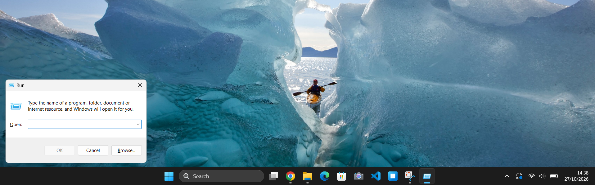
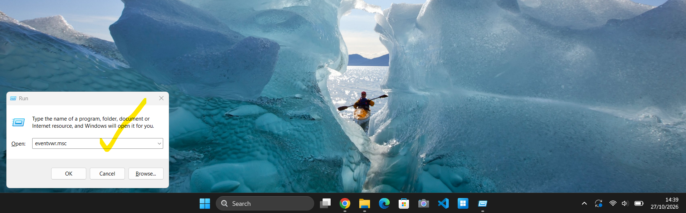
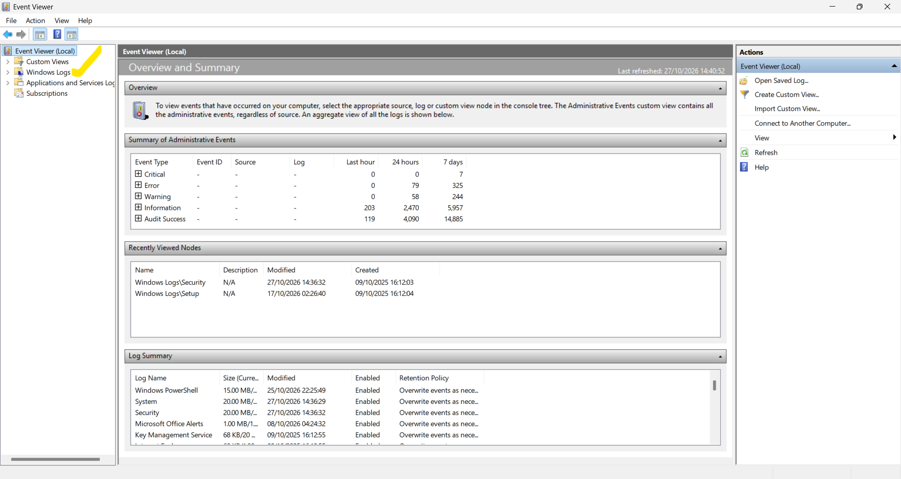
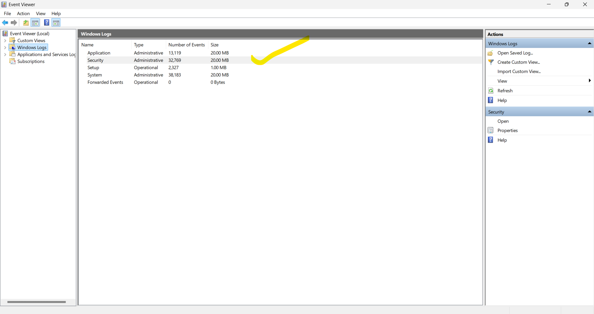
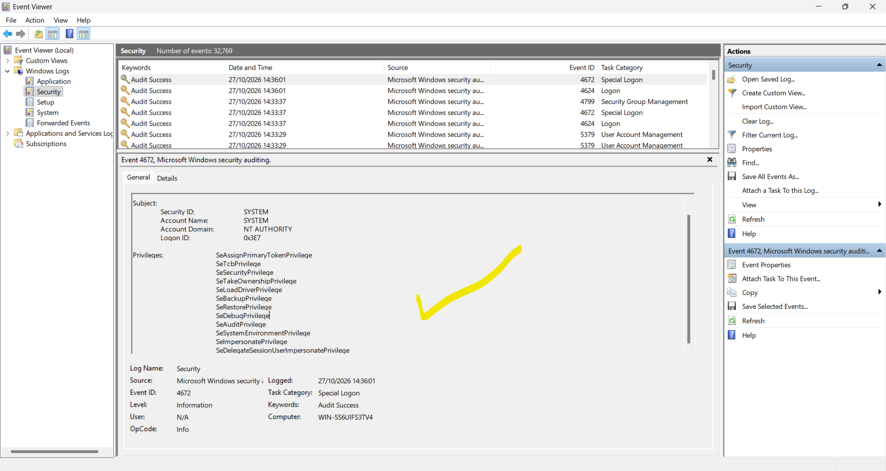
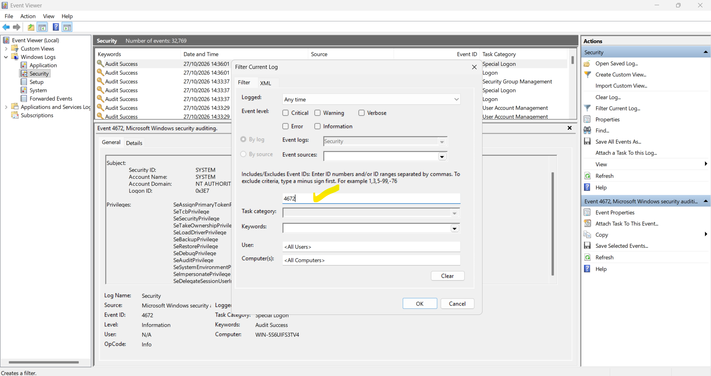
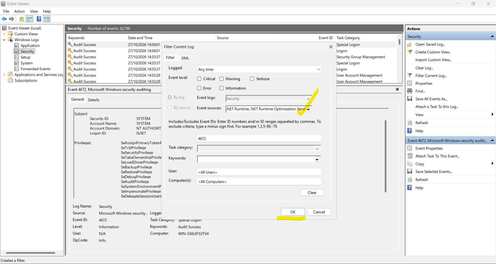
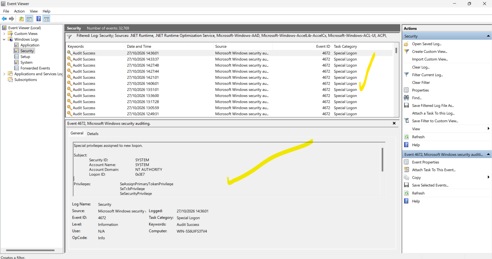

Day 1.2 — Privileged Logon Investigation (Event ID 4672)
========================================================

Status: Initial investigation completed — 27 October 2026

Objective
---------
Investigate Windows Security Event ID 4672, identify the account receiving special privileges, and assess whether the observed activity warrants further investigation or escalation.

Environment
-----------
- Windows 11 endpoint
- Windows Event Viewer → Windows Logs → Security
- Windows PowerShell (additional Day 1 command-line evidence)

Investigation procedure
-----------------------
1. Opened the Windows Run dialog and launched Event Viewer using `eventvwr.msc`.
2. Navigated to Windows Logs and selected the Security log.
3. Reviewed the retained Security audit events.
4. Opened an Event ID 4672 record and inspected its Subject and Privileges fields.
5. Used Filter Current Log to focus on Event ID 4672.
6. Reviewed the resulting privileged-logon records and documented the findings.

Evidence — Event Viewer
-----------------------

**1. Open the Windows Run dialog**

Used the Windows Run interface to launch the event monitoring console.



**2. Launch Event Viewer**

Entered `eventvwr.msc` to open the native Windows log investigation tool.



**3. Review the Event Viewer overview**

Confirmed that Windows Event Viewer was available and displaying the local event-log summary.



**4. Locate the Security log**

Navigated to Windows Logs and identified the Security log, which contained 32,769 retained events at the time of the screenshot.



**5. Inspect a privileged-logon event**

Opened Event ID 4672 and examined the Subject fields and the privileges granted to the built-in SYSTEM account.



**6. Filter for Event ID 4672**

Used Filter Current Log and entered `4672` in the Event IDs field to focus on privileged-logon events.



**7. Check the event-source filter**

Reviewed the Event Sources selector. The screenshot shows additional selected sources; these should be cleared or verified when an unrestricted search is required.



**8. Review the filtered results**

Observed multiple Event ID 4672 entries and inspected a SYSTEM account event with Logon ID `0x3E7`. The active source filters limit the scope of this view.



PowerShell cross-check — Day 1 evidence
---------------------------------------

As a command-line cross-check, used PowerShell to retrieve the 30 most recent Security events matching IDs 4624, 4625 and 4672:

```powershell
Get-WinEvent -FilterHashtable @{LogName='Security'; ID=4624,4625,4672} -MaxEvents 30
```


The results include repeated 4672 privileged-logon events alongside 4624 successful-logon events. Event ID 4625 was not among these 30 results; this limited sample cannot establish that no failed logons occurred. Matching timestamps alone do not prove the events belong to the same logon session; compare account and Logon ID fields for confirmation.

Investigation findings
----------------------
- Event ID: **4672** — Special privileges assigned to a new logon
- Event time observed: **27 October 2026, 14:36:01**
- Account: **SYSTEM**
- Domain: **NT AUTHORITY**
- Logon ID: **0x3E7**
- Example privileges observed: `SeAssignPrimaryTokenPrivilege`, `SeTcbPrivilege`, `SeSecurityPrivilege`
- Several 4672 records were visible in the filtered Security log.

SOC Tier 1 assessment
---------------------
The reviewed 4672 event is consistent with routine privileged activity by the built-in Windows SYSTEM account. A 4672 event alone does not indicate compromise. To confirm relationships between logons, correlate the relevant 4624 and 4672 records using account, Logon ID, and time rather than timestamps alone.

**Disposition:** No malicious activity established from the reviewed record. Further correlation would be appropriate if other indicators or alerts were present.

Limitations
-----------
- The exact process or service responsible was not independently identified.
- An Event Sources selection is visible in some filter screenshots. Filter criteria should be reviewed before treating a result set as exhaustive.
- Device-identifying details in screenshots should be redacted before public sharing.

Skills demonstrated
-------------------
- Windows Security event investigation
- Privileged-logon analysis
- Event Viewer filtering
- SOC Tier 1 triage and evidence documentation
- Distinguishing observations from conclusions

References
----------
- [Microsoft: Event 4672 — Special privileges assigned to new logon](https://learn.microsoft.com/en-us/windows/security/threat-protection/auditing/event-4672)
- [Microsoft: Event 4624 — Successful logon](https://learn.microsoft.com/en-us/windows/security/threat-protection/auditing/event-4624)
- [MITRE ATT&CK](https://attack.mitre.org/)
