Day 1 — Windows Security Event Monitoring
=========================================

Status: In progress — initial evidence captured on 27 October 2026.

Objective
---------
Investigate real Windows Security log records using Event Viewer, document evidence, and distinguish observed facts from unverified assumptions.

Evidence walkthrough
--------------------

The screenshots are organised in `Day-01/images/` and embedded below in the order of the practical exercise.

Day 1.1 — Event Viewer setup and baseline
-----------------------------------------

Opened Windows Event Viewer and navigated to Windows Logs > Security. The log displayed approximately 32,713 retained events at inspection time.

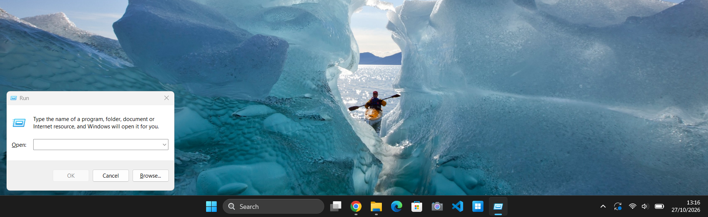

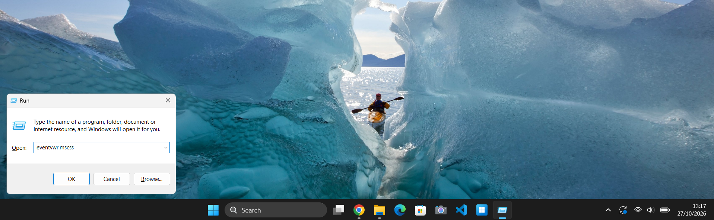

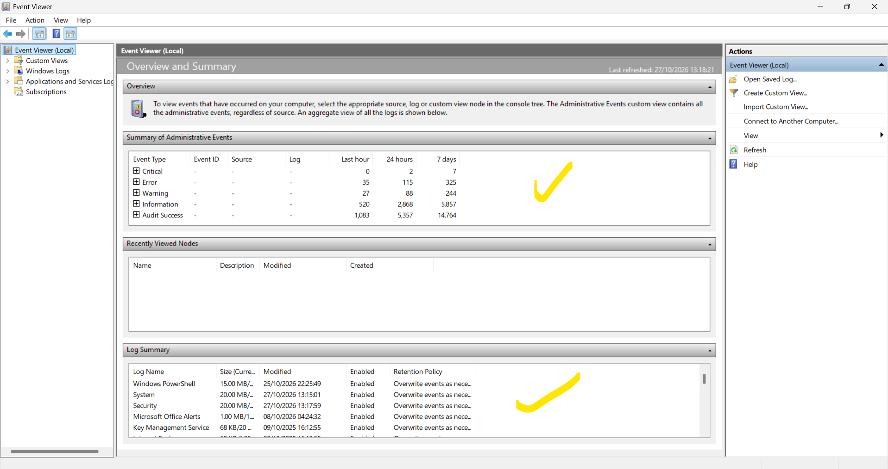

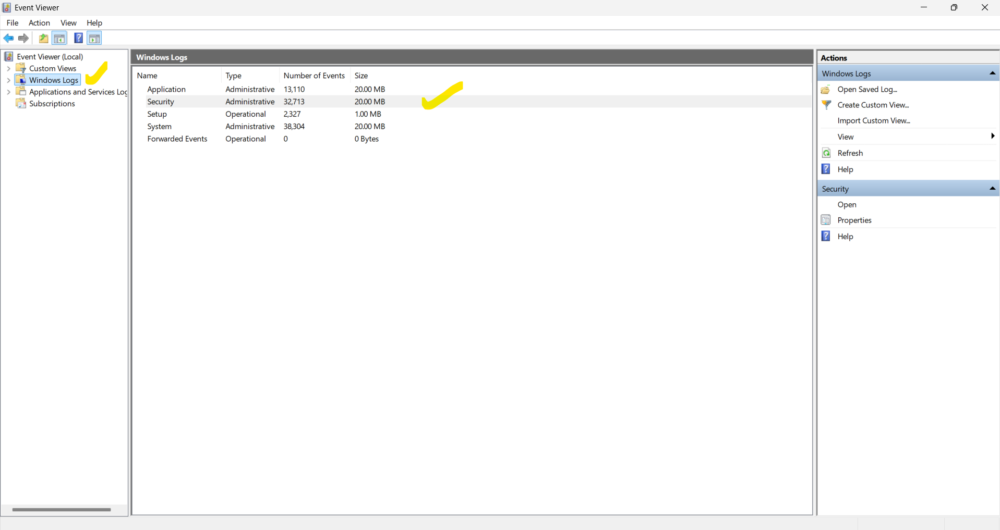

Day 1.2 — Privileged logon observation (4672)
---------------------------------------------

Observed Event ID 4672, which records special privileges assigned to a new logon. This alone does not establish suspicious activity.

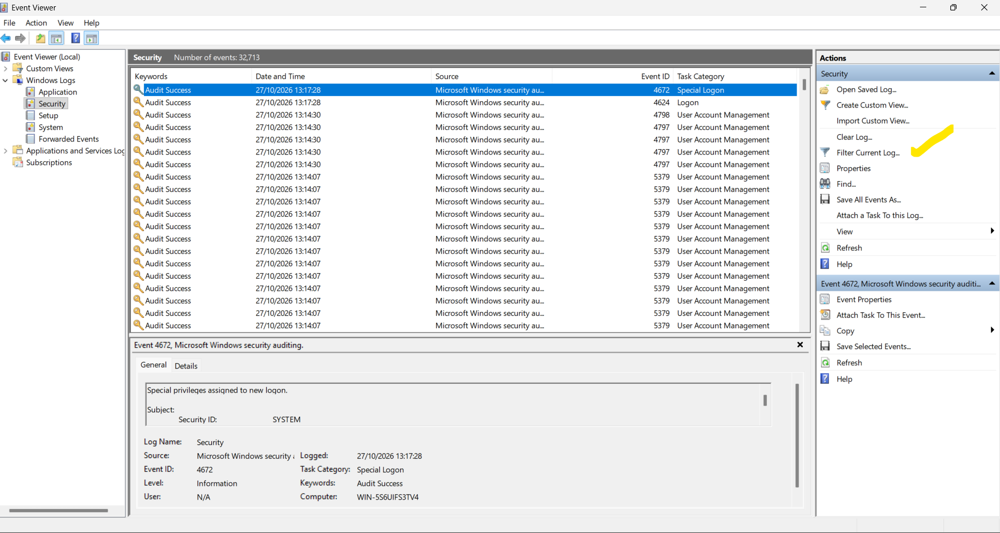

Day 1.3 — Failed logon filter (4625)
------------------------------------

The initial filtered view showed no matches for Event ID 4625. **Validation needed:** screenshots indicate an Event Sources restriction may also have been active; clear all other filters and repeat the check before concluding there were no failed logons.

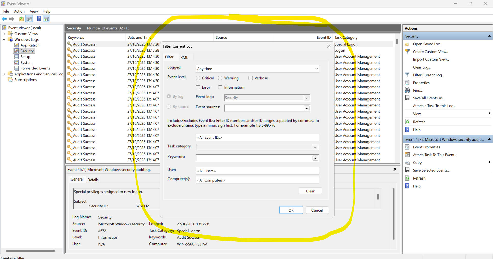

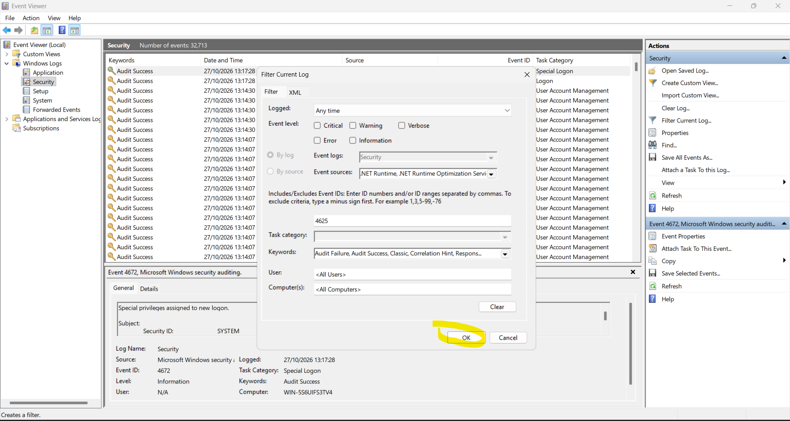

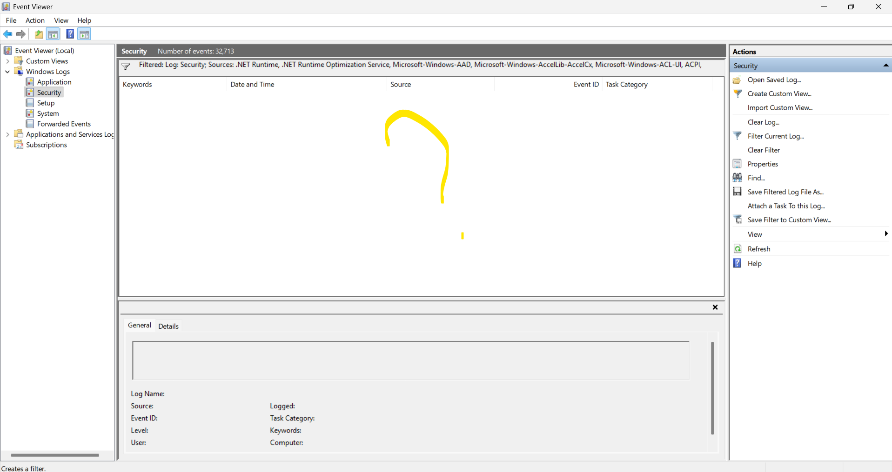

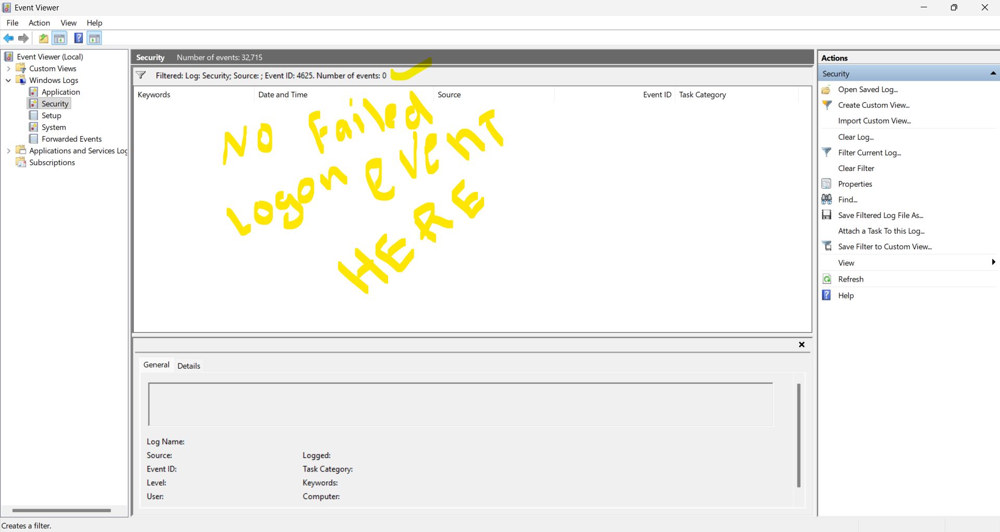

Day 1.4 — Successful logon investigation (4624)
-----------------------------------------------

Examined a 4624 event showing Logon Type 5 (service), NT AUTHORITY\\SYSTEM, Logon ID `0x3E7` and an elevated token. These fields are consistent with service activity, but the initiating service was not independently verified.

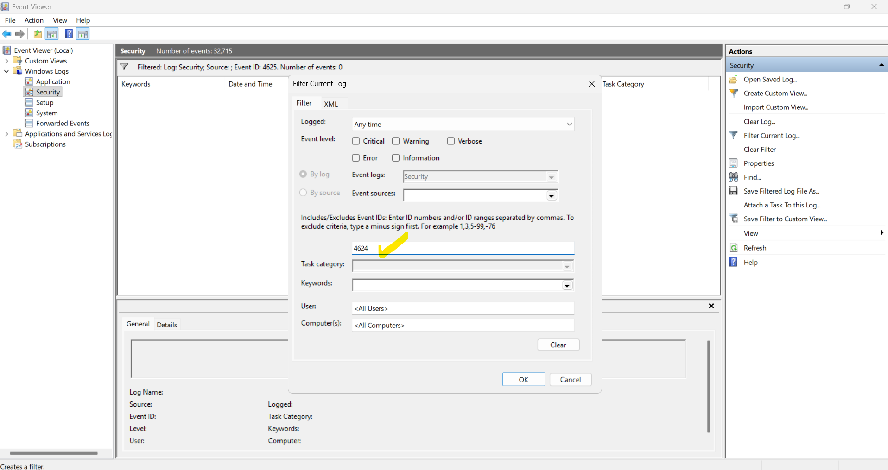

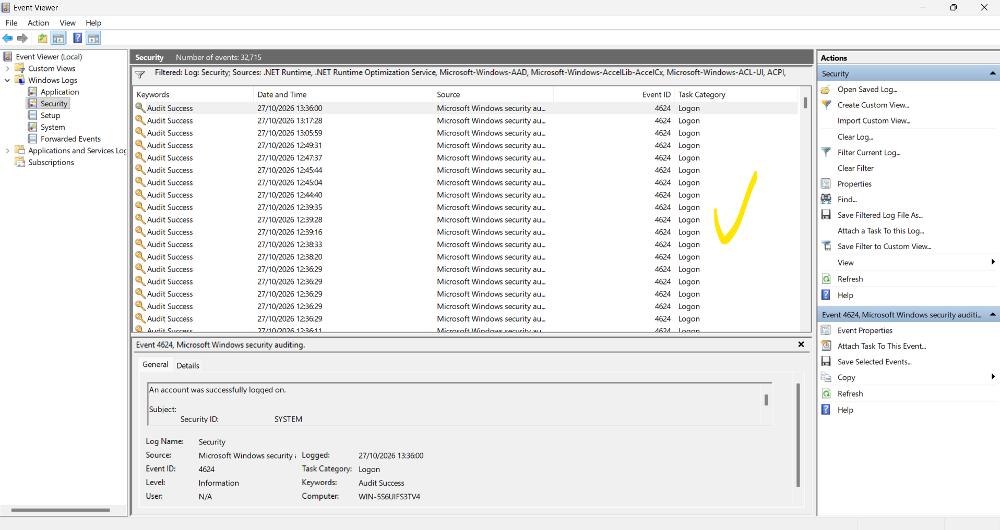

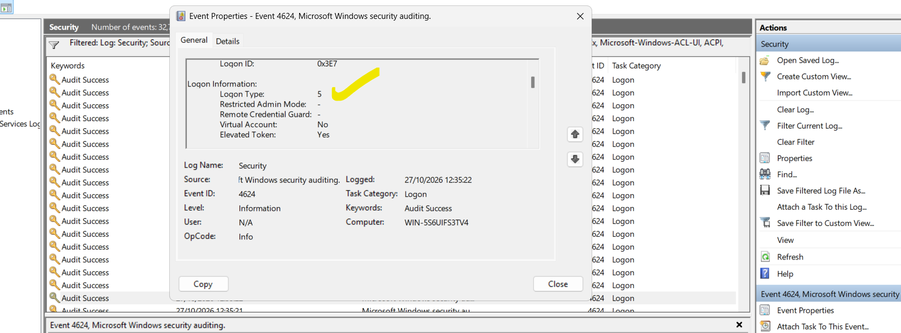

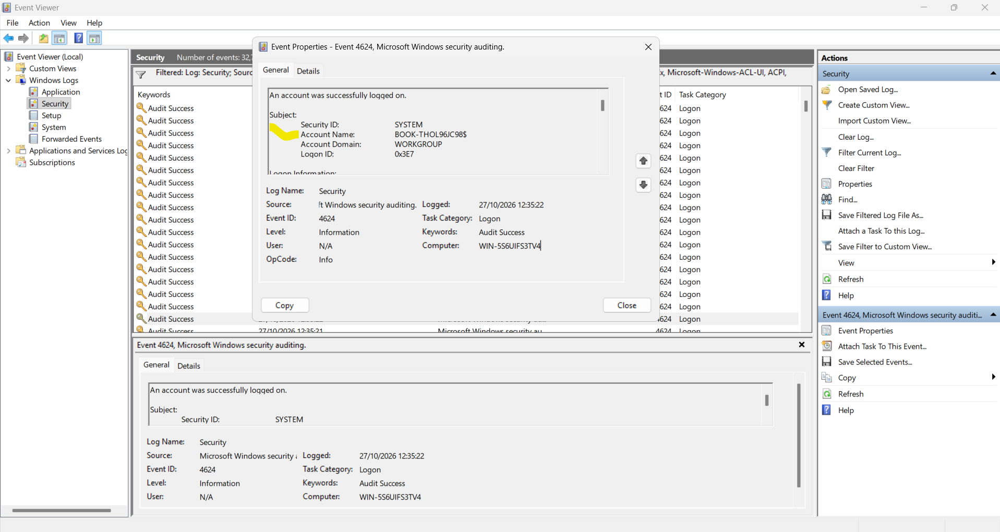

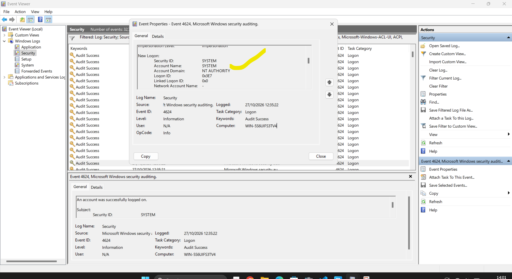

Investigation 001 — Service logon
---------------------------------
- Source: Windows Security event log
- Event ID: 4624
- Date/time displayed: 2026-10-27 12:35:22
- Logon Type: 5 — Service
- New Logon Account: SYSTEM
- Domain: NT AUTHORITY
- Logon ID: 0x3E7
- Elevated Token: Yes
- Assessment: Consistent with Windows service authentication; no compromise established from the reviewed fields.
- Limitation: The specific service/process was not confirmed.

Next practical checks
---------------------
- [x] Open Event Viewer and inspect Security log
- [x] Review 4672 and 4624 events
- [x] Capture and embed 19 screenshots
- [ ] Clear all Event Sources restrictions and recheck Event ID 4625
- [ ] Examine an interactive (Type 2) or unlock (Type 7) logon
- [ ] Redact any personal or device-identifying information in screenshots before sharing publicly

References
----------
- [Microsoft Event 4624](https://learn.microsoft.com/en-us/windows/security/threat-protection/auditing/event-4624)
- [Microsoft Event 4625](https://learn.microsoft.com/en-us/windows/security/threat-protection/auditing/event-4625)
- [Microsoft Event 4672](https://learn.microsoft.com/en-us/windows/security/threat-protection/auditing/event-4672)
- [MITRE ATT&CK](https://attack.mitre.org/)
