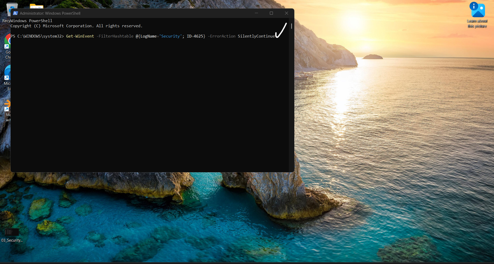
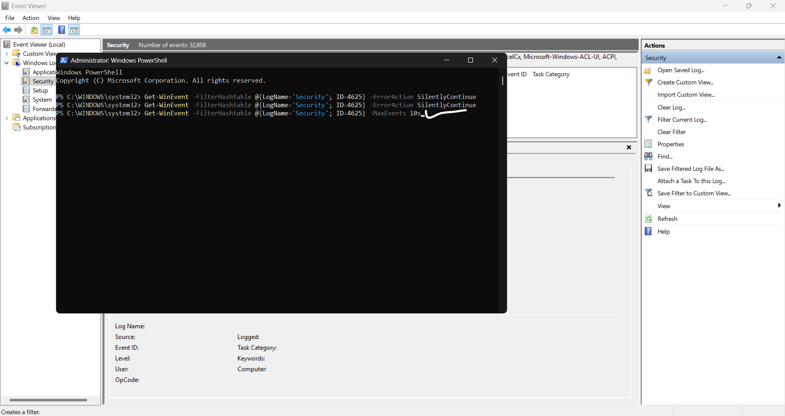
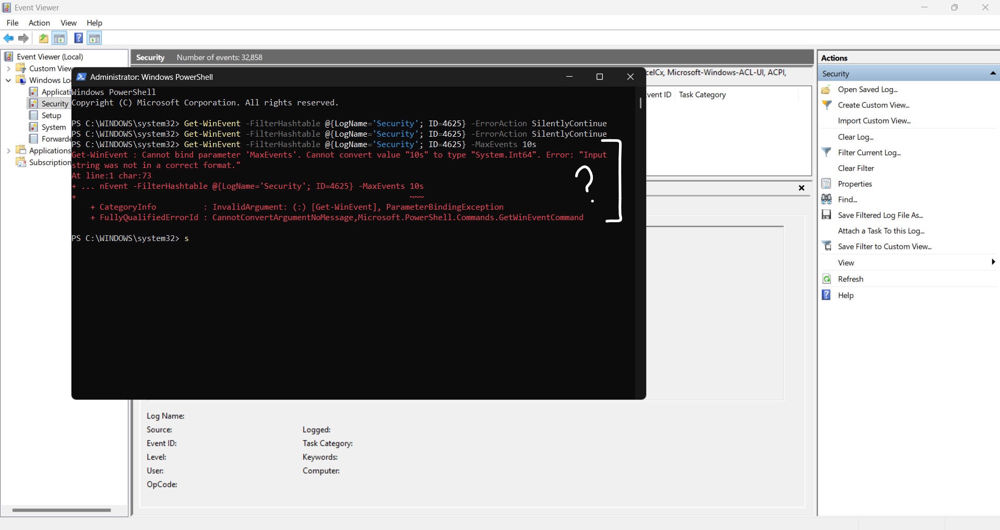

Module 1.3 — Failed Logon Investigation (Event ID 4625)
====================================================

Status: Verification completed — 27 October 2026

Objective
---------
Determine whether failed Windows sign-in events (Security Event ID 4625) are present in the retained local Security log, and verify the Event Viewer findings independently with PowerShell.

Method
------
1. Opened Windows Event Viewer → Windows Logs → Security and filtered for Event ID 4625.
2. The filtered view showed zero matches, but additional Event Sources appeared in the filter. This view alone was not reliable enough to establish that no events existed.
3. Opened Windows PowerShell as Administrator and queried the Security log directly by Event ID, without Event Viewer source restrictions.
4. Re-ran the command without suppressed errors to distinguish a genuinely empty result from a command failure.

Screenshot evidence
-------------------

**1. Initial PowerShell query**

The initial query used `-ErrorAction SilentlyContinue`, which can hide a no-matches message and other errors. A blank result alone is therefore insufficient evidence.



**2. Repeated query**

The same filtered query was repeated. The absence of displayed records prompted a check without error suppression.



**3. Invalid parameter**

A first attempt to limit results used `-MaxEvents 10s`. PowerShell correctly rejected this because `MaxEvents` requires an integer. This is a command syntax error, not a security event.



**4. Corrected command**

The parameter was corrected to the integer `10`.


Final verification
------------------

The following command was executed:

```powershell
Get-WinEvent -FilterHashtable @{LogName='Security'; ID=4625} -MaxEvents 10
```

The final PowerShell output was provided separately in the investigation conversation (not visible in these four screenshots):

```text
Get-WinEvent : No events were found that match the specified selection criteria.
FullyQualifiedErrorId : NoMatchingEventsFound,Microsoft.PowerShell.Commands.GetWinEventCommand
```

SOC Tier 1 findings
-------------------
- **Event ID investigated:** 4625 — An account failed to log on
- **Source:** Local Windows Security log
- **Event Viewer result:** Zero matching events, but the original GUI filter had additional source restrictions
- **Independent verification:** PowerShell reported `NoMatchingEventsFound` for Event ID 4625
- **Assessment:** No 4625 records were found in the retained Security log at the time of the query
- **Limitation:** This does not establish that failed sign-ins never occurred, or that every possible sign-in failure was audited and retained
- **Disposition:** Investigation check complete; no failed-logon evidence identified in the reviewed log. No security incident established from this check.

Skills demonstrated
-------------------
- Windows Security log filtering
- Independent validation using `Get-WinEvent`
- PowerShell parameter troubleshooting
- Distinguishing empty results from suppressed errors
- SOC Tier 1 evidence handling and accurate reporting

References
----------
- [Microsoft — Event 4625](https://learn.microsoft.com/en-us/windows/security/threat-protection/auditing/event-4625)
- [Microsoft — Get-WinEvent](https://learn.microsoft.com/en-us/powershell/module/microsoft.powershell.diagnostics/get-winevent)
- [Main Module 01 investigation](../README.md)
