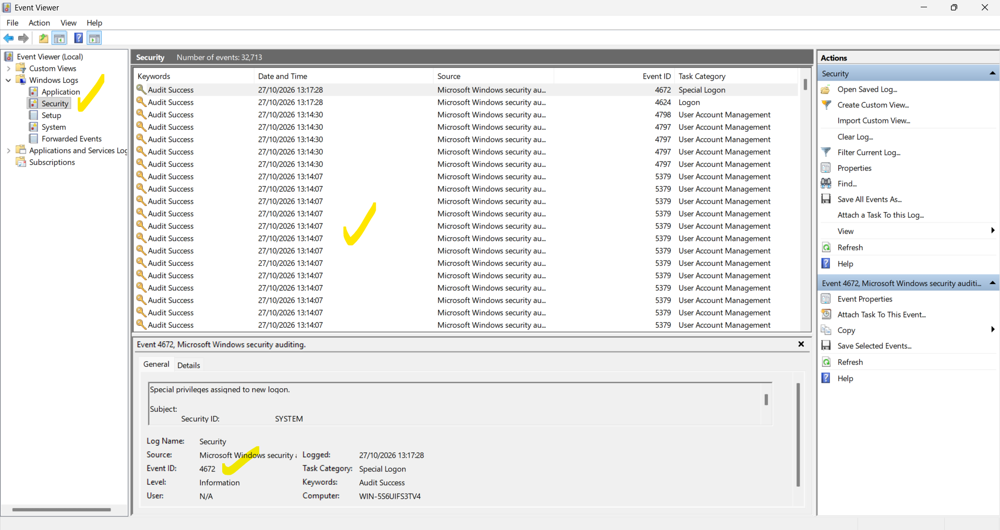
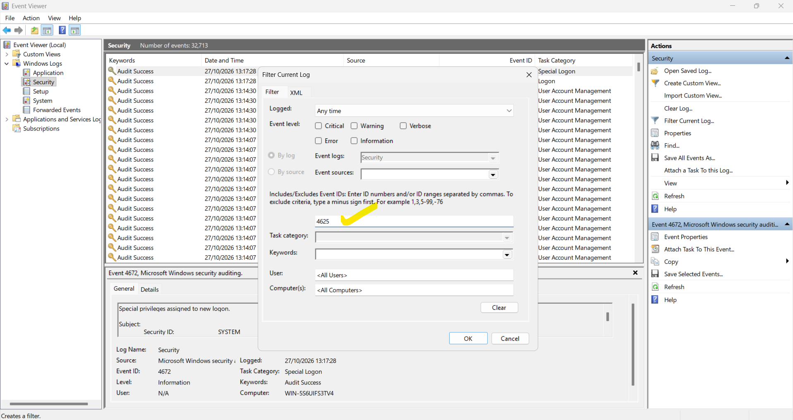
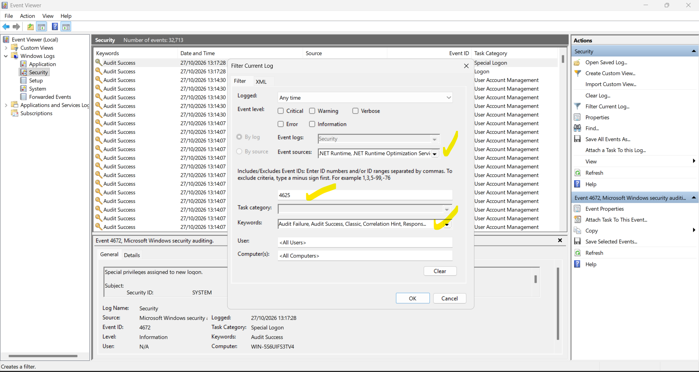
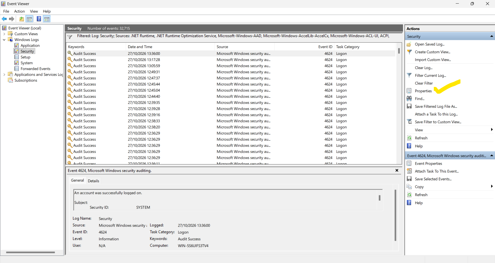
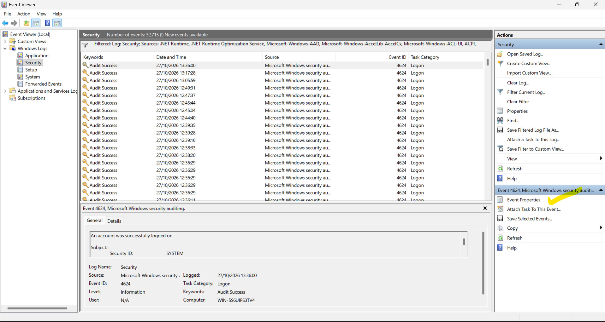
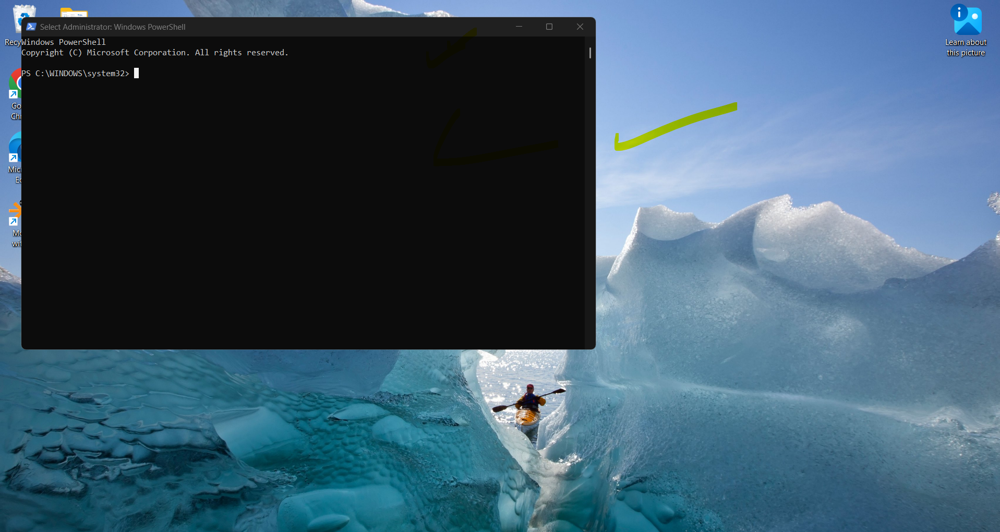
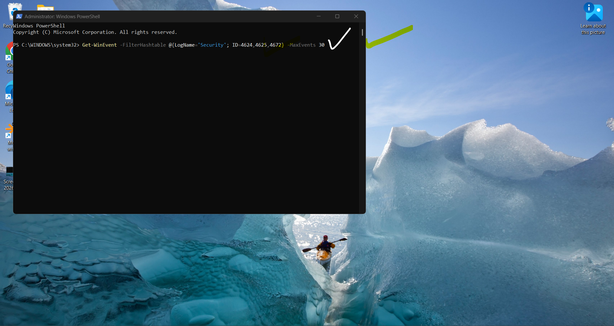
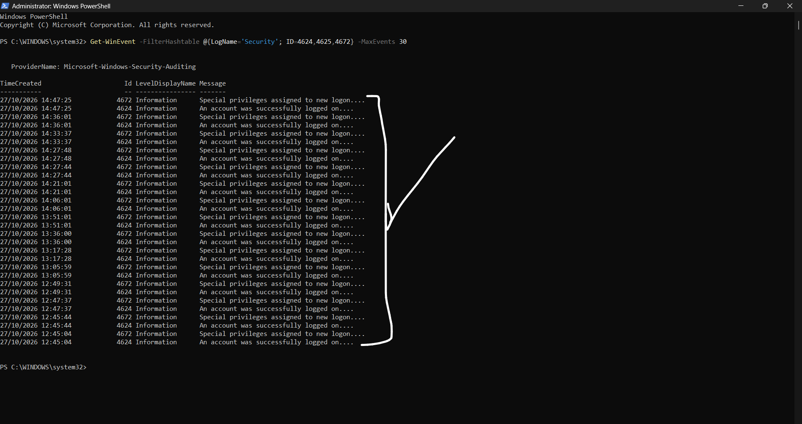

Module 01 — Windows Security Event Monitoring
=========================================

Status: In progress — Event Viewer and PowerShell evidence captured on 27 October 2026; Module 1.3 failed-logon verification completed.

Objective
---------
Investigate real Windows Security log records using Event Viewer, document evidence, and distinguish observed facts from unverified assumptions.

Evidence walkthrough
--------------------

The screenshots are organised in `Module-01/images/` and embedded below in the order of the practical exercise.

Module 1.1 — Event Viewer setup and baseline
-----------------------------------------

Opened Windows Event Viewer and navigated to Windows Logs > Security. The log displayed approximately 32,713 retained events at inspection time.




Module 1.2 — Privileged logon observation (4672)
---------------------------------------------

Observed Event ID 4672, which records special privileges assigned to a new logon. This alone does not establish suspicious activity.


Module 1.3 — Failed logon filter (4625)
------------------------------------

The initial filtered view showed no matches for Event ID 4625, but Event Sources restrictions were visible. An independent PowerShell query subsequently returned `NoMatchingEventsFound` for Event ID 4625 in the retained Security log. This verifies no matching records were found at the time of the query, not that failed logons never occurred. [See the completed Module 1.3 investigation and four screenshots](Module-01.3/README.md).







Module 1.4 — Successful logon investigation (4624)
-----------------------------------------------

Examined a 4624 event showing Logon Type 5 (service), NT AUTHORITY\\SYSTEM, Logon ID `0x3E7` and an elevated token. These fields are consistent with service activity, but the initiating service was not independently verified.







Module 1.5 — PowerShell Security Log Investigation
-----------------------------------------------

Objective: Demonstrate basic SOC Tier 1 command-line investigation using the same Windows Security event log reviewed in Event Viewer. PowerShell provides an alternative interface when the Event Viewer graphical application is unavailable, provided the underlying event logs remain accessible.

Step 1 — Open Windows PowerShell as Administrator



Step 2 — Run a single command to retrieve recent authentication and privileged-logon events

```powershell
Get-WinEvent -FilterHashtable @{LogName='Security'; ID=4624,4625,4672} -MaxEvents 30
```



Step 3 — Review the returned security events



SOC Analyst findings

- The command successfully retrieved the latest 30 matching records from the Windows Security log.
- Event ID 4624 (successful logon) and Event ID 4672 (special privileges assigned) appeared repeatedly in the results.
- Event ID 4625 (failed logon) did not appear among those 30 records. This does **not** establish that no failed logons exist elsewhere in the retained log.
- Several 4624 and 4672 entries share timestamps. This suggests potentially related logon activity, but matching account and Logon ID fields is necessary to confirm correlation.
- This exercise demonstrates basic PowerShell log filtering and initial triage. It does not independently establish malicious activity.

Evidence status: Three PowerShell screenshots captured and embedded. This is a command-line supplement to the earlier Event Viewer investigation, not a repeat of the full investigation.

SOC case report
---------------

[**SOC-001 — Windows Security Event Investigation Report**](SOC-001-Windows-Security-Event-Investigation/README.md) consolidates the Event IDs 4624, 4625 and 4672 findings, PowerShell verification, evidence links, limitations and case disposition.

Investigation 001 — Service logon
---------------------------------
- Source: Windows Security event log
- Event ID: 4624
- Date/time displayed: 2026-10-27 12:35:22
- Logon Type: 5 — Service
- New Logon Account: SYSTEM
- Domain: NT AUTHORITY
- Logon ID: 0x3E7
- Elevated Token: Yes
- Assessment: Consistent with Windows service authentication; no compromise established from the reviewed fields.
- Limitation: The specific service/process was not confirmed.

Next practical checks
---------------------
- [x] Open Event Viewer and inspect Security log
- [x] Review 4672 and 4624 events
- [x] Capture and embed 19 Event Viewer screenshots
- [x] Demonstrate PowerShell Get-WinEvent filtering and embed 3 screenshots
- [x] Independently verify Event ID 4625 with PowerShell (no matching records found)
- [ ] Examine an interactive (Type 2) or unlock (Type 7) logon
- [ ] Redact any personal or device-identifying information in screenshots before sharing publicly

References
----------
- [Microsoft Event 4624](https://learn.microsoft.com/en-us/windows/security/threat-protection/auditing/event-4624)
- [Microsoft Event 4625](https://learn.microsoft.com/en-us/windows/security/threat-protection/auditing/event-4625)
- [Microsoft Event 4672](https://learn.microsoft.com/en-us/windows/security/threat-protection/auditing/event-4672)
- [MITRE ATT&CK](https://attack.mitre.org/)
